<p align="center">
  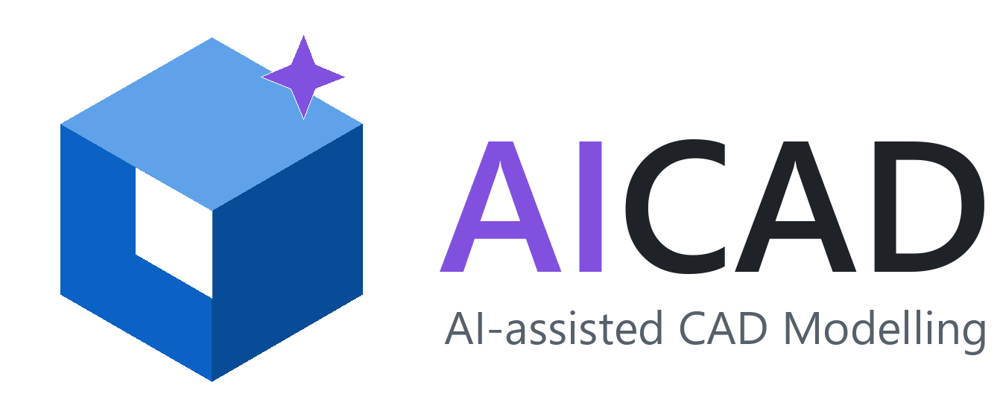
</p>

<p align="center">
  <a href="https://github.com/HyoseokByun-opt/AICAD/releases/latest"></a>
  
  
  
  
  
  
  
</p>

<p align="center">
  <b>AICAD (AI-assisted CAD Modelling)</b> turns engineering drawings - single parts, machines, plant structures and
  drawing sets of many sheets - or a written description into parametric 3D solids, and exports them as STEP and as
  beam and shell models for analysis. A vision-language model reads the drawing on the local GPU, the OpenCASCADE
  kernel builds the solid; nothing leaves the PC.
</p>

<p align="center">
  <a href="#from-drawing-to-model">Gallery</a> ·
  <a href="#software-description">Description</a> ·
  <a href="#large-objects-and-drawing-sets">Drawing sets</a> ·
  <a href="#cad-editing">CAD editing</a> ·
  <a href="#analysis-model-beams-and-shells">Analysis model</a> ·
  <a href="#hardware-and-models">Hardware and models</a> ·
  <a href="#installation">Installation</a> ·
  <a href="#usage">Usage</a> ·
  <a href="#verification">Verification</a> ·
  <a href="docs/GUIDE_KO.md">User guide (Korean)</a>
</p>

<p align="center">
  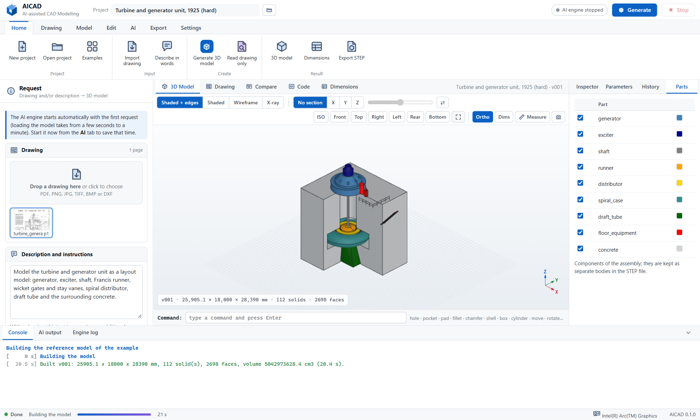
</p>

## At a glance

- **Drawings in, STEP out.** PDF (vector or scanned), PNG, JPEG, TIFF of up to 280 megapixels, BMP, WebP and DXF,
  single sheets or whole sets; feet-inches and metric; graphic scale bars are measured on the sheet.
- **Sizes the drawing leaves out** are measured by ratio on the sheet and listed with their source.
- **Machines and plants** are broken into components that are modelled, checked and corrected one by one, then
  assembled into one STEP assembly with named, coloured parts.
- **CAD editing** with a command line and clicks in the 3D view: hole, pocket, pad, fillet, chamfer, shell, box,
  cylinder, move, rotate, mirror, array, delete - each a parametric feature in a history.
- **Analysis model:** members and pipes become beams, thin walls become shells; STEP and a solver input deck.
- **Offline:** one package with the Python runtime, all packages and the llama.cpp engines; the AI model is copied
  once. No administrator rights, no internet on the working PC.

## From drawing to model

| Drawing | Model | |
|---|---|---|
| 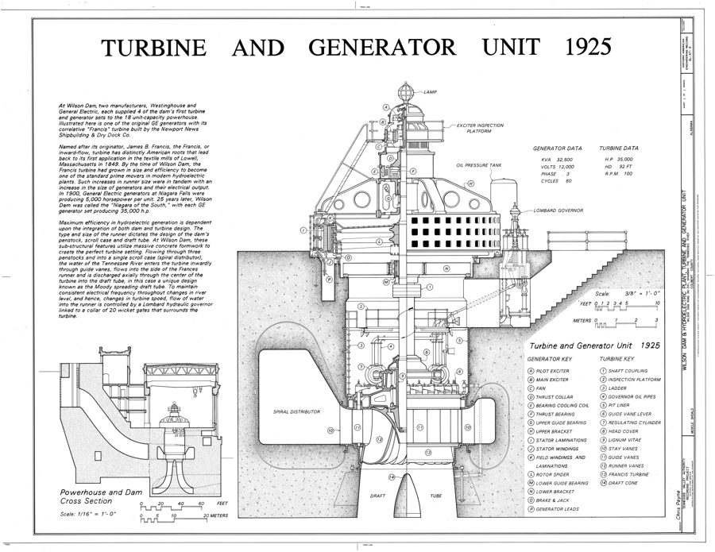 | 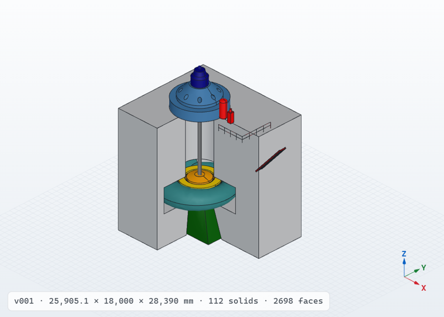 | **Turbine and generator unit, 1925** (HAER, Wilson Dam). A half section without a single dimension; sizes from the measured scale bars. Layout model with the modelling library: 9 components, 112 solids. |
| 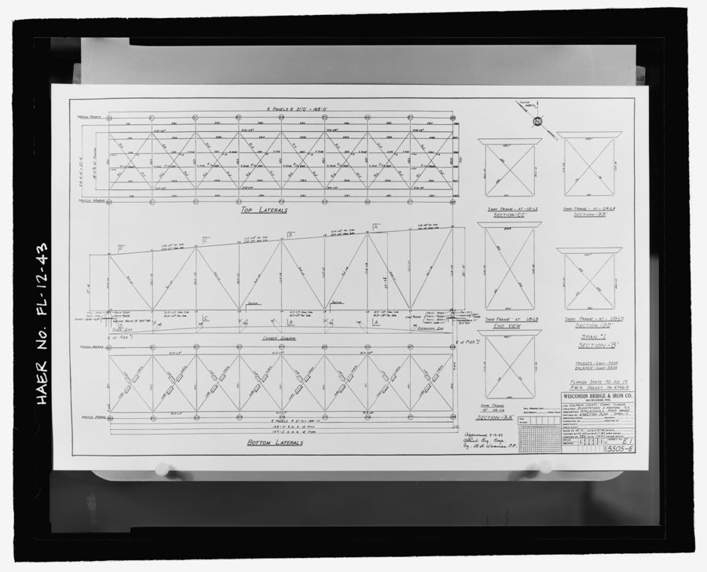 | 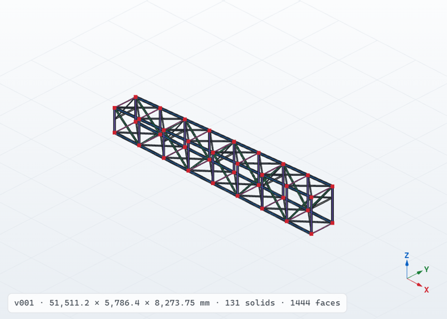 | **Steel deck truss, 1934** (HAER). Photograph of an erection plan in feet and inches. 131 members, shown with the beam model derived from them: 131 beams, 36 member ends joined, 1 180 elements. |
| 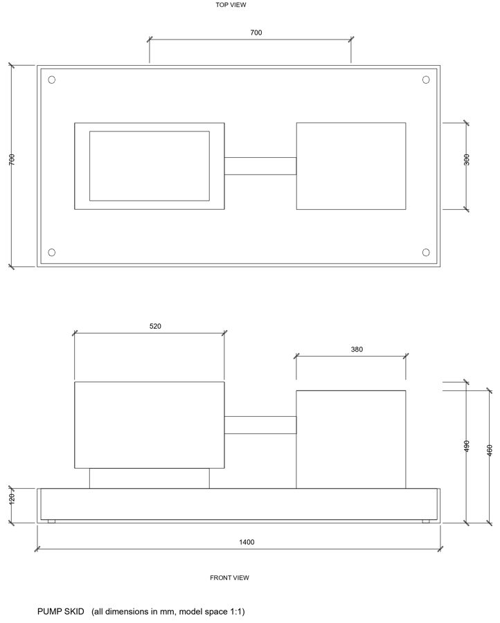 | 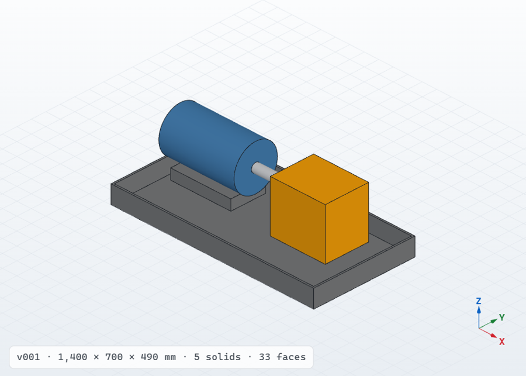 | **Pump skid** (DXF). Base frame, motor, pump and coupling as a five-part assembly; DXF dimensions give the exact scale. |
| *(description only)* | 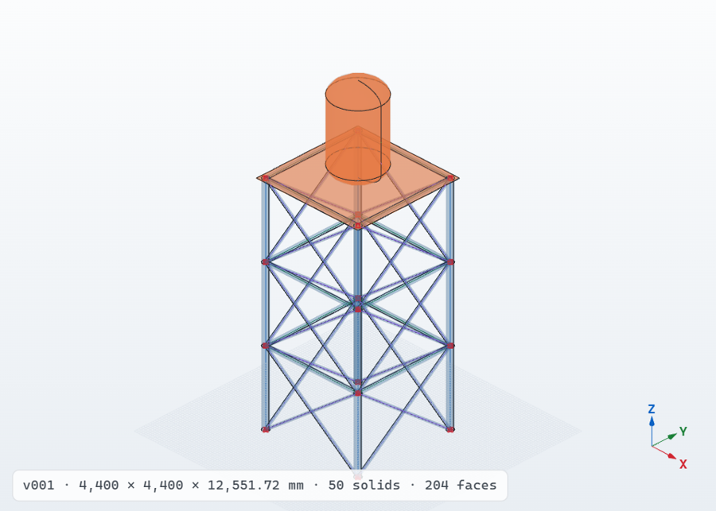 | **Tower of pipes with a deck and a tank**, from words alone. Analysis model: 48 pipe beams, the deck plate and the tank (shell and heads) as shells sharing nodes with the leg tops. |
| 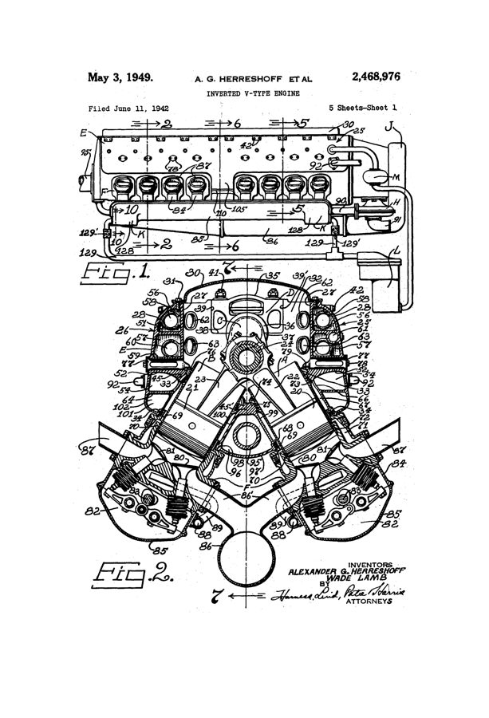 | 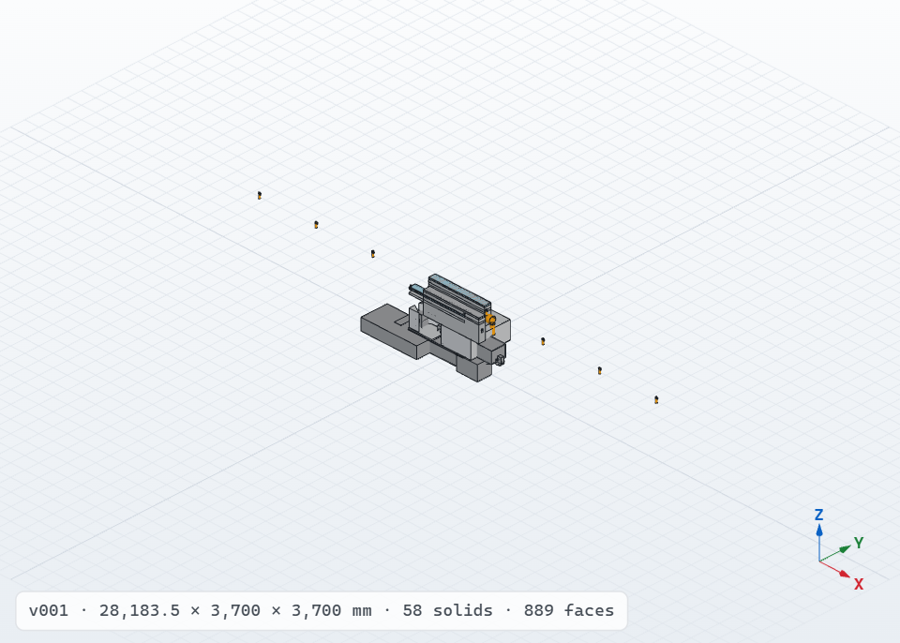 | **Inverted V-16 engine, five sheets** (US patent 2,468,976), modelled by the AI from all five sheets: 11 of 11 components (crankcase, banks, heads, covers, manifolds, sump, gear and accessory housings).\* |
| 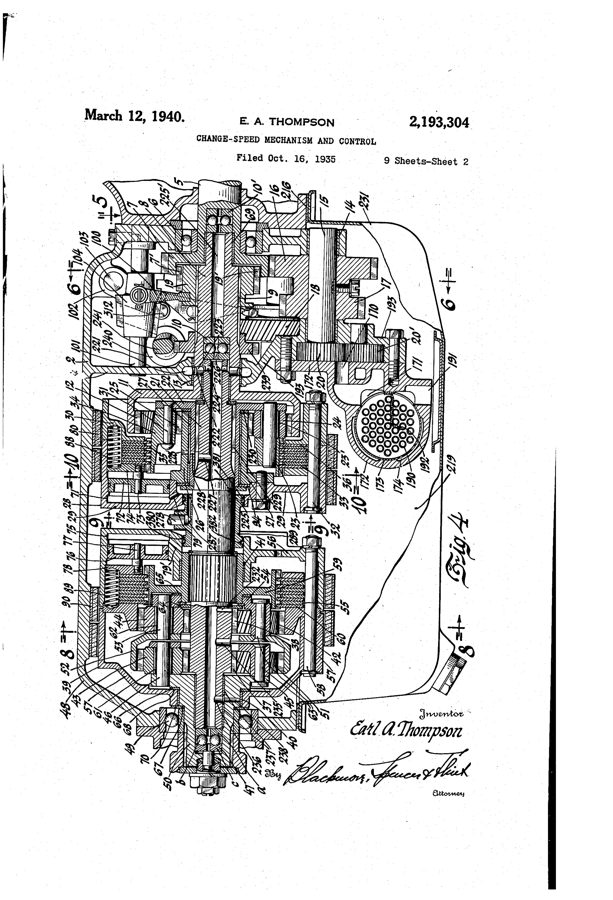 | 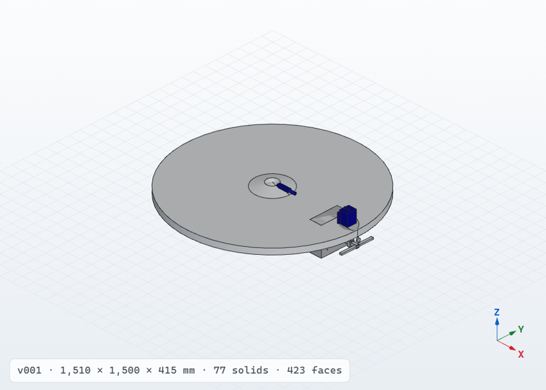 | **Automatic transmission, three sheets** (US patent 2,193,304), modelled by the AI: 10 of 10 components (case, shafts, planetary set with 39 solids, clutch, band, pump, valve body).\* |

\* AI results of the test runs described under [Verification](#verification), made with the compact test model
(Qwen3.6-35B-A3B in 2-bit quantisation) on a laptop CPU without a GPU. They show the complete pipeline at work -
all sheets read, components planned, modelled, checked and assembled - and also its limits with a small model:
some components came out at the wrong size or orientation (the engine's banks stand upright, the transmission case
lies flat). The intended models run on the GPU with reasoning switched on.

## Software description

AICAD has been developed to automate the conversion of equipment and part drawings into 3D CAD models. Drawings
are received as PDF files, scanned or photographed images, or DXF exports; for many of them no 3D model exists, and
the model has to be built by hand. AICAD reads such a drawing with a vision-language model running on the local GPU,
writes a parametric model script for the CadQuery modelling library, builds the solid on the OpenCASCADE kernel,
compares the result with the drawing view by view, and corrects the model until the two agree. The final solid is
written as a STEP file (AP214 by default, AP203 and AP242 on request) together with STL, glTF, BREP, a 2D DXF
drawing, a beam and shell analysis model and the model script itself.

Drawings frequently omit sizes that a 3D model needs. AICAD measures such sizes on the sheet: the written dimensions
fix the scale of each view (mm per pixel), the AI marks the two ends of every missing size, and the size follows from
the measured distance. Every value used for the model is listed with its provenance - written on the drawing,
measured by ratio, stated by the user, or assumed - and can be corrected before or after modelling.

All processing takes place on the user's PC. The program, the Python runtime, the packages and the AI engine are
distributed as one offline package; the AI model is downloaded once and copied to the PC. No drawing, description or
model leaves the machine.

- **Input.** PDF (text written by a CAD program is read exactly from the file; the OCR layer of a scanned PDF is
  marked as such), PNG, JPEG, TIFF (multi-page), BMP, WebP and DXF (rendered from model space; dimension entities give
  their measured values and the drawing scale is exact). A written description can replace the drawing or complement
  it with information the drawing lacks.
- **Reading.** The AI identifies the projection method, the views and their position on the sheet, every written
  dimension with its meaning, the modelling features in order, and the sizes that have to be measured. View boxes are
  snapped to the linework of the sheet; the scale is derived from each view and checked for consistency.
- **Modelling.** The model is a CadQuery script with a parameter block: every dimension is a named number with its
  source. Single parts and assemblies (named, coloured bodies kept as separate products in the STEP file) are
  supported. The script runs in an isolated worker process with a static safety check; a kernel failure or an endless
  loop cannot affect the program.
- **Correction.** A script that fails is returned to the AI with the error, the line and specific hints (fillet larger
  than the wall, revolve profile across the axis, selector without result, open profile) until it builds.
- **Comparison with the drawing.** Hidden-line projections of the model are computed in the views of the drawing.
  The overall size per axis and the filled outline of each view are compared with the drawing (intersection over
  union after normalisation, with detection of mirrored features). Drawing and model views are composed side by side
  and returned to the AI, which corrects the script; the best version is kept.
- **Editing.** Parameters are changed in a table and rebuilt in a fraction of a second without the AI. Changes in
  words ("make the plate 5 mm thicker and add a 2 mm chamfer on the top edges") are applied by the AI. Features are
  added by hand with the [CAD commands](#cad-editing). The script itself can be edited on the Code tab. Every build is
  kept as a version.
- **Viewing.** Interactive 3D view with Z up, orthographic and perspective projection, shaded, edge, wireframe and
  see-through styles, a section plane with coloured cut faces, face picking (plane normal, cylinder diameter and
  axis, cone angle, area), point-to-point measurement, overall dimensions and the six standard views.

## Large objects and drawing sets

Plant structures, steel frameworks, machines and equipment are usually drawn on several sheets, often as old prints,
scans or photographs, in feet and inches, with graphic scales instead of dimensions. A single prompt cannot hold
such a set and a single script for hundreds of members fails as a whole, so AICAD models large objects in steps
that each fit the model and fail on their own:

1. **Survey.** Every sheet is described at overview resolution: title, kind, units, views with their captions and
   levels, tables, scale notes and graphic scale bars.
2. **Zoomed reading.** Every main view is read again from the original file (a re-render of the PDF page or the
   full-resolution scan); a view drawn large is read in up to six overlapping tiles and the answers are merged.
   Dimensions, levels, grid lines, labels and member marks are converted to millimetres (feet-inches with fractions,
   inches, metres). An answer that starts repeating itself is stopped and asked again.
3. **Scale per view.** Graphic scale bars - alternating blocks, or rulers with ticks inside a frame - are found and
   measured by image analysis near the place the AI points to; the AI only reads their labels, and the feet and metre
   bars of a sheet must agree. A view without a bar takes the scale of the dimensions read in it or the ratio of its
   scale note to that of a view with a bar. Views without any scale are given in pixels, and one size stated in the
   request fixes them all.
4. **Plan.** The object is broken into components (foundation, frames, machines, vessels, piping, platforms) with
   bounding boxes in one global coordinate system. The plan receives every label at its position measured on the
   drawing in millimetres - legend entries such as "A PILOT EXCITER" at the place of their callout "A" - so that the
   parts keep the order in which they are drawn.
5. **Components.** One script per component, written with the modelling library and corrected on its own. A
   component built far from its planned box gets one placement correction; a component that still fails or lies far
   off becomes a see-through placeholder at its planned place, and the rest is kept.
6. **Assembly.** One script with a builder function per component gives one version: a STEP assembly with named,
   coloured components. A component can be redone later, with an instruction, without reading the drawings again.

The **modelling library** (`aicad_lib`) gives the AI building blocks that keep large structures short and robust:
steel members and frames from node lists (HEB/HEA/IPE/UPN, H/I/C/L by size, US W shapes and inch angles, pipes,
hollow sections), plan and section outlines extruded between elevations, revolved half sections, grating, stairs,
ladders and handrails, pipes, flanges and nozzles, vessels with 2:1, hemispherical or conical heads (solid or hollow),
spiral casings, circle-to-rectangle transitions (draft tubes, ducts, hoppers), blade rows, bolt circles and patterns.

## Workflow

<p align="center">
  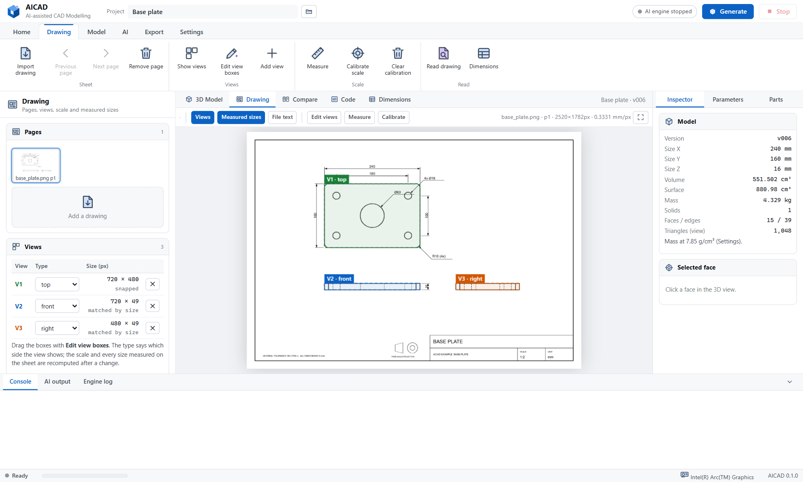
  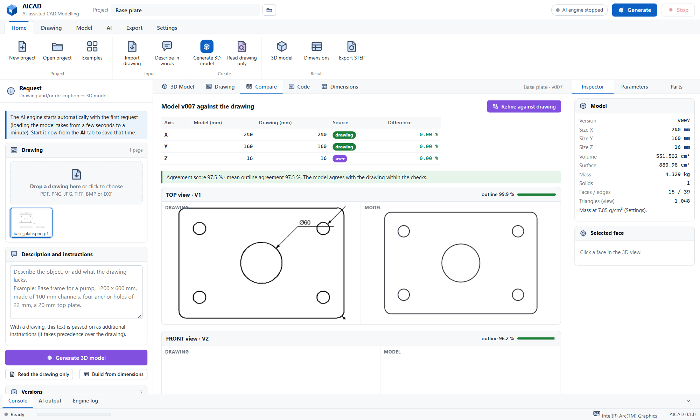
</p>

1. **Import** drawings (drag and drop or Home → Import drawing) and/or describe the object in words.
2. **Generate.** The AI engine starts if it is not running and loads the model into the graphics memory.
   - *Read*: the AI returns the specification (views, dimensions, features, sizes to measure). The program snaps the
     view boxes, derives the scale and measures the missing sizes.
   - *Write*: the AI writes the CadQuery script from the table of values and the drawing.
   - *Build and correct*: the script is built; errors are corrected automatically (4 attempts by default).
   - *Compare and refine*: the model is projected into the views of the drawing and compared; the AI refines the
     script (2 rounds by default) and the version that agrees best is kept.
3. **Review** on the Dimensions tab (every value with its source), the Drawing tab (view boxes, measured sizes; boxes
   can be moved and the scale calibrated by two points of known distance) and the Compare tab.
4. **Adjust** parameters, add features with the CAD commands, ask for changes in words, or edit the script.
5. **Export** STEP, other formats or the analysis model from the Export tab.

## CAD editing

<p align="center">
  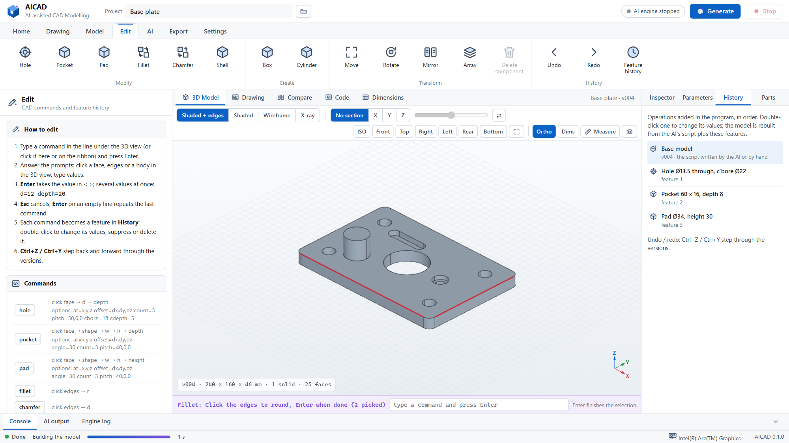
</p>

The generated model can be finished by hand. A command is typed in the command line under the 3D view (typing
anywhere in the window goes there) or started from the **Edit** tab of the ribbon. The command then asks, step by
step, for what it needs: a face or edges clicked in the 3D view, and values typed in the command line.

- **Enter** takes the default shown in `< >`; Enter on an empty line repeats the last command; **Esc** cancels.
- Several values can be given at once as `key=value`, e.g. `pad shape=circle w=30 height=25` or
  `hole d=13.5 count=4 pitch=0,60,0`. The position is the clicked point, or `at=x,y,z`, shifted by `offset=dx,dy,dz`.
- **Tab** completes a command name; ↑ and ↓ recall earlier commands; **Ctrl+Z** and **Ctrl+Y** undo and redo.

| Command (alias) | Picks | Values |
|---|---|---|
| `hole` (h) | face | diameter, depth (0 = through); `cbore=`, `cdepth=`, `count=`, `pitch=` |
| `pocket` (p) | face | shape rect / circle / slot, width, height, depth; `angle=`, `count=`, `pitch=` |
| `pad` (boss, extrude) | face | shape, width, height of the outline, pad height |
| `fillet` (f), `chamfer` (c) | edges, Enter when done | radius / size |
| `shell` | the face to open | wall thickness |
| `box` (b), `cylinder` (cyl) | the face it stands on | sizes; join: add, cut or new body |
| `move` (m), `rotate` (ro) | body or component | displacement / axis and angle about the clicked point |
| `mirror` (mi), `array` (ar) | body or component | plane / number of copies and step |
| `delete` (del) | component | removes a component of an assembly |

Each command becomes a feature block at the end of the model script. Faces and edges are referenced by the clicked
point (the nearest face or edge of the current solid is taken), so features usually stay valid when parameters
further up change; a feature whose point no longer lies on the intended face is corrected in the History. The
**History** tab on the right lists the features: double-click (or ✎) to edit the values, ○ to suppress, ✕ to delete.
The model is rebuilt without the AI in about a second.

## Analysis model (beams and shells)

<p align="center">
  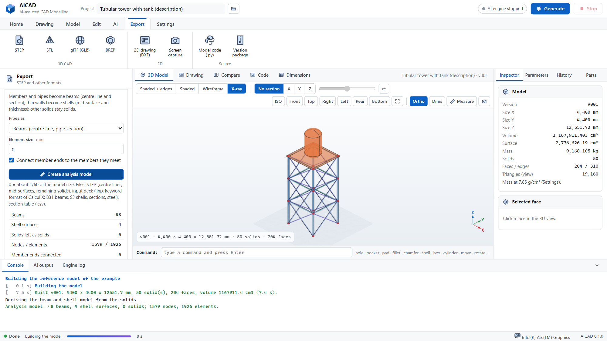
</p>

Structures of pipes and rolled sections, frames, platforms and vessels are usually analysed with beam and shell
elements rather than with solid elements. **Export → Analysis model** derives such a model from the solids of the
current version, the way an analyst idealises a structure by hand:

| Solid | Becomes | Properties |
|---|---|---|
| Straight member of constant section (rolled section, bar, tube) longer than 4 times its section | beam on the centre line | section measured on the end face: rod, pipe, rectangle, box and I shapes recognised; area, second moments and torsion constant for any section |
| Pipe run of straight pieces and bends (cylinders and tori) | chain of straight and curved beams | pipe or rod section |
| Thin wall: two faces at a small, constant distance (plate, sheet, vessel shell, dished head, duct) | shell on the mid-surface | thickness measured between the faces |
| Ball at a pipe joint | left out (the pipes meet at its centre) | |
| Anything else (castings, blocks, machines) | kept as a solid | to be meshed with solid elements from the STEP file |

Pipes can be taken either as beams or as shells. A member that stops at the side of another member (a beam at the
face of a column) is joined to that member's centre line, and beam ends that lie on a mid-surface become nodes of
the shell mesh, so the parts of the model are connected. The output is a STEP file with the centre lines, the
mid-surfaces and the remaining solids, named per component; an input deck in the keyword format of
[CalculiX](http://www.calculix.de/) with nodes, B31 beam elements, S3 shell elements, the sections and steel as
material (pipe, rod, rectangle and box as standard sections, other shapes as general sections with area, second
moments and torsion constant); and a section table (CSV) with length, area, moments, thickness and mass of every
member and wall. The model is drawn over the see-through solids in the 3D view. Supports, loads and the analysis
step are added in the solver or pre-processor.

Checked against hand calculation (self-test): an HEB300 member gives A = 14 282 mm², I = 2.419·10⁸ mm⁴ and
J = 1.488·10⁶ mm⁴; a pipe 168.3 × 7.1 is written as `SECTION=PIPE` with r = 84.15, t = 7.1; the shell meshes cover
their surfaces (flat 100 %, vessel heads 98.9 %).

Limits: shells are not joined to each other along their edges (two plates meeting at a corner keep their mid-surface
gap of half a thickness), crossing members without a common end are not connected, and curved shells are meshed
from the surface tessellation. Library vessels are hollow only when their wall thickness is given (`lib.vessel(...,
t=12)`); otherwise they are solid envelopes.

## Hardware and models

The AI engine is [llama.cpp](https://github.com/ggml-org/llama.cpp) (build b11606) with CUDA 12.4; Vulkan and CPU
builds are included as well. The model is chosen automatically from the graphics memory of the PC; any other GGUF
vision model can be placed in `models/`.

| Profile | Model (all Apache-2.0) | Weights + vision projector | Context | Intended GPU | On the release |
|---|---|---|---|---|---|
| `qwen3.6-27b-q6` | [Qwen3.6-27B](https://huggingface.co/Qwen/Qwen3.6-27B), Q6_K ([unsloth GGUF](https://huggingface.co/unsloth/Qwen3.6-27B-GGUF)) | 22.5 + 0.9 GB | 65 536 | 48 GB (RTX 6000 Ada) | yes, in parts |
| `qwen3.6-27b-q4` | Qwen3.6-27B, Q4_K_M | 16.8 + 0.9 GB | 32 768 | 24 GB (RTX 4090) | yes, in parts |
| `qwen3.6-35b-a3b-q4` | [Qwen3.6-35B-A3B](https://huggingface.co/Qwen/Qwen3.6-35B-A3B), Q4_K_M ([unsloth GGUF](https://huggingface.co/unsloth/Qwen3.6-35B-A3B-GGUF)) | 22.1 + 0.9 GB | 65 536 | 48 GB, optional, faster | Hugging Face |
| `qwen3.6-35b-a3b-iq2` | Qwen3.6-35B-A3B, IQ2_XXS (projector Q8_0 by [ggml-org](https://huggingface.co/ggml-org/Qwen3.6-35B-A3B-GGUF)) | 10.8 + 0.6 GB | 32 768 | 12-16 GB, or CPU with 16 GB RAM | Hugging Face |
| `qwen3.5-9b-q4` | [Qwen3.5-9B](https://huggingface.co/Qwen/Qwen3.5-9B), Q4_K_M | 5.7 + 0.9 GB | 32 768 | 8-16 GB or CPU | Hugging Face |
| `qwen3.5-4b` | [Qwen3.5-4B](https://huggingface.co/Qwen/Qwen3.5-4B), Q4_K_M | 2.7 + 0.7 GB | 16 384 | CPU trial only | yes, in parts |

Qwen3.6-27B (Qwen team, Alibaba Cloud) is a dense vision-language model with a native context of 262 144 tokens. It
is the largest model of its series that fits both a 48 GB and a 24 GB card with the context the pipeline needs
(drawing image, specification, script, comparison image); the quantisation is chosen per card. Reasoning
("thinking") is used for reading, writing and changes, and switched off for error correction; each can be set on the
AI tab. On the CPU engine reasoning is always off.

## Installation

AICAD runs on Windows 10 and 11 (64-bit). Neither administrator rights nor an internet connection are needed on the
PC where it runs; the files are downloaded once on any PC with internet and copied over (USB drive, network share).

### What you need

| | RTX 4090 PC | RTX 6000 Ada / A6000 Ada PC | Any PC (trial) |
|---|---|---|---|
| Graphics card | NVIDIA, 24 GB | NVIDIA, 48 GB | none needed |
| NVIDIA driver | 551.61 or newer (CUDA 12.4) | 551.61 or newer (CUDA 12.4) | - |
| Memory (RAM) | 32 GB or more | 32 GB or more | 16 GB |
| Free disk space | 25 GB | 30 GB | 8 GB |
| AI model | `qwen3.6-27b-q4` (17.7 GB) | `qwen3.6-27b-q6` (23.5 GB) | `qwen3.5-4b` (3.4 GB) |

The driver version is shown by `nvidia-smi` in a command prompt (top line, "Driver Version").

### Step 1 - Download the files (on a PC with internet)

Open the [latest release](https://github.com/HyoseokByun-opt/AICAD/releases/latest). Under **Assets**, download:

| File | Needed | Content |
|---|---|---|
| `AICAD-0.1.0-offline-win64.zip` (about 1.1 GB) | always | the program, the Python 3.11 runtime, all packages, the three llama.cpp engines (CUDA, Vulkan, CPU), examples and documentation |
| `AICAD-0.1.0-model-qwen3.6-27b-q4-part01of10.zip` ... `part10of10.zip` | RTX 4090 | Qwen3.6-27B Q4_K_M, split into parts below GitHub's 2 GiB limit per file |
| `AICAD-0.1.0-model-qwen3.6-27b-q6-part01of13.zip` ... `part13of13.zip` | RTX 6000 Ada | Qwen3.6-27B Q6_K, likewise |
| `AICAD-0.1.0-model-qwen3.5-4b-part01of02.zip`, `part02of02.zip` | trial without GPU | Qwen3.5-4B Q4_K_M |
| `SHA256SUMS.txt` | recommended | the SHA-256 checksum of every file above |

Download **every** part of the model you need - a model with a missing part does not start. The exact number of
parts per model is shown in the file names (`partNNofMM`) and in the release notes. Both 27B models may be
downloaded if the same files are to serve both PCs.

*Optional check.* In PowerShell, in the download folder:

```powershell
Get-FileHash -Algorithm SHA256 .\AICAD-0.1.0-offline-win64.zip
```

The value must equal the one next to the file name in `SHA256SUMS.txt`. (The installer in step 3, option B, checks
every model part automatically.)

### Step 2 - Unpack the program (on the working PC)

1. Copy the downloaded files to the working PC, for example into `C:\Users\<name>\Downloads\AICAD`.
2. Create the folder `C:\AICAD`. Use a short path without spaces or non-English letters; avoid OneDrive and network
   folders (Windows limits paths to 260 characters, and the package has deep folders).
3. Right-click `AICAD-0.1.0-offline-win64.zip` → **Extract All...** → enter `C:\AICAD` → **Extract**.

The result is the program folder `C:\AICAD\AICAD-0.1.0\`:

```
C:\AICAD\AICAD-0.1.0\
    1_INSTALL_OFFLINE.bat   2_RUN_AICAD.bat   3_GET_AI_MODEL.bat   4_SELF_TEST.bat   5_RUN_SERVER.bat
    app\  docs\  engine\  examples\  models\  runtime\  tools\  wheels\  README.md  LICENSE
```

### Step 3 - Put the AI model in place

**Option A - unzip the parts by hand.** Unzip *every* part of the model into the **same folder as in step 2**
(`C:\AICAD`, not into `AICAD-0.1.0`): right-click a part → Extract All... → `C:\AICAD` → Extract; repeat for each
part. Each part already contains the path `AICAD-0.1.0\models\<profile>\`, so all pieces land together:

```
C:\AICAD\AICAD-0.1.0\models\qwen3.6-27b-q4\
    Qwen3.6-27B-Q4_K_M-00001-of-00010.gguf
    ...
    Qwen3.6-27B-Q4_K_M-00010-of-00010.gguf
    mmproj-F16.gguf
    LICENSE-qwen3.6-27b-q4.txt
```

The model stays split in these `-0000N-of-000NN.gguf` files; the engine reads them together as one model. Do not
rename them.

**Option B - let the installer check and unpack them.** Copy all parts and `SHA256SUMS.txt` into
`C:\AICAD\AICAD-0.1.0\` (next to `3_GET_AI_MODEL.bat`), double-click `3_GET_AI_MODEL.bat` and choose **20**. Every part
is checked against its SHA-256 checksum before it is unpacked; a damaged or missing part is named. The zip files can
be deleted afterwards.

**Option C - download directly (working PC with internet).** Double-click `3_GET_AI_MODEL.bat` and choose 1 (RTX
4090), 2 (RTX 6000 Ada), 3 (both) or 8 (automatic for this PC's GPU) to download from Hugging Face, or 11 / 12 / 13
for the same models from the GitHub release. Downloads resume after an interruption and every file is checked. Behind
a company proxy, set it first in the same command prompt: `set HTTPS_PROXY=http://proxy.example.com:8080`.

### Step 4 - Install

Double-click `C:\AICAD\AICAD-0.1.0\1_INSTALL_OFFLINE.bat`. It

1. unpacks the Python 3.11.9 runtime into `python\` (nothing is installed in Windows itself),
2. installs the bundled packages from `wheels\` without internet,
3. runs the self-test: about 20 checks of the CAD kernel, imports, exports and the analysis model.

This takes 2 to 5 minutes. The window ends with `... passed, 0 failed` and, when a model is in place, lists it under
`model ...`. Deleting the `python\` folder undoes the installation; deleting `C:\AICAD` removes everything.

### Step 5 - Start

Double-click `2_RUN_AICAD.bat`. A console window opens (keep it open - closing it ends the program and the AI engine)
and the browser shows AICAD at `http://127.0.0.1:8100`.

- The AI engine starts with the first request, or on the AI tab with **Start engine**. Loading the 27B model takes
  about half a minute to two minutes; the status in the title bar changes to *AI engine ready* and shows the GPU.
- Try it: Home → **Examples** → *Base plate* → **Generate**. The AI reads the drawing, writes the model and checks it
  against the drawing; the STEP file is then on the Export tab.
- To use AICAD from other PCs of the office network, start `5_RUN_SERVER.bat` instead; the other PCs open
  `http://<name or IP of this PC>:8100` in their browser and the AI runs on this PC's GPU. Windows may ask to allow
  the program through the firewall (private networks).

### Step 6 - Check (optional)

- `4_SELF_TEST.bat` repeats the self-test; `4_SELF_TEST.bat --ai` also loads the model and asks it one question.
- Settings tab → *Installed AI models* lists every model found and whether it is complete.
- AI tab → the engine shows *CUDA* and the name of the graphics card. *CPU* means the GPU was not used (see
  troubleshooting).

### Updating and moving

A new version is unpacked next to the old one (`C:\AICAD\AICAD-0.2.0\`). Copy the `models\` folder (or move it, to
save space) and, to keep your projects, the `workspace\` folder from the old version; then run `1_INSTALL_OFFLINE.bat`
of the new version. The project folder can also be set in Settings → Workspace.

### Troubleshooting

| Symptom | Cause and remedy |
|---|---|
| "No AI model is installed" | `models\<profile>\` is missing, or a part was not unzipped. Check that every `-0000N-of-000NN.gguf` file and `mmproj-F16.gguf` are there (Settings → Installed AI models shows *incomplete*); unzip the missing part, or use option B, which names it. |
| The engine does not start | Read the Engine log (bottom dock). Update the NVIDIA driver to 551.61 or newer. As a test, choose Settings → Engine → *Vulkan*. |
| Very slow; the AI tab shows *CPU* | No NVIDIA GPU was found, or the driver is too old. With an RTX card, update the driver and restart AICAD. |
| "out of memory" on the GPU | Another program uses the graphics memory, or the model is too large for the card: use `qwen3.6-27b-q4` on 24 GB cards, or lower Settings → Context length. |
| "file name too long" during installation | The folder path is too long: unpack to `C:\AICAD` as in step 2. |
| The installation window closes at once | Run the .bat from a command prompt (`cmd`, `cd C:\AICAD\AICAD-0.1.0`, `1_INSTALL_OFFLINE.bat`) to read the message. |
| Antivirus software blocks `llama-server.exe` | Allow `engine\cuda\llama-server.exe`; it is the unchanged llama.cpp server (MIT licence) and listens only on 127.0.0.1. |
| The browser does not open | Open `http://127.0.0.1:8100` by hand. If port 8100 is taken, start `python\python.exe app\run_web.py --port 8101 --open` in the program folder. |
| A model part is damaged | Its SHA-256 differs from `SHA256SUMS.txt`: download that part again (option B names it). |

### From source (developers)

```
git clone https://github.com/HyoseokByun-opt/AICAD.git
cd AICAD
python tools/build_offline.py      (on a PC with internet: Python runtime, wheels and llama.cpp builds)
1_INSTALL_OFFLINE.bat
3_GET_AI_MODEL.bat                 (or put the model parts in place as in step 3)
2_RUN_AICAD.bat
```

`python tools/make_release.py` builds the offline package and `python tools/make_model_parts.py <profile>` the model
parts of a release.

## Usage

| Task | Where |
|---|---|
| Model from a drawing | Import the drawing → **Generate** |
| Model from words | Type the description on the Home tab → **Generate** |
| Plant, structure, machine, several sheets | Import all sheets → Object: *Assembly / structure* (automatic for several sheets) → **Generate** |
| Redo one component | Parts / Components → *Redo* (optionally with an instruction) |
| Check what was read | **Dimensions** tab: every value, its source and the open questions |
| Fix a wrong view box or the scale | **Drawing** tab → *Edit view boxes*, *Calibrate scale* |
| Rebuild from corrected values | Dimensions tab → *Build model from these values* |
| Change a size | **Parameters** (right panel) → *Apply* |
| Add a hole, pocket, fillet ... by hand | Type the command (or **Edit** tab), click the face, type the values |
| Change or remove a hand-made feature | **History** (right panel): double-click, hide, delete; Ctrl+Z |
| Beam and shell model for analysis | Export tab → *Analysis model* → *Create analysis model* |
| Change the design in words | AI tab → *Change the model by instruction* |
| Improve agreement with the drawing | Compare tab → *Refine against drawing* |
| Measure the model | 3D toolbar → *Measure*; click a face for its geometry |
| Export | Export tab → STEP, STL, glTF, BREP, DXF, code |

Fifteen examples are included (Home → Examples). Seven are synthetic, with known answers: a base plate (raster), a
pipe flange (vector PDF), an L bracket whose wall thickness is not dimensioned, a pump skid assembly (DXF), and three
descriptions (a vertical vessel, a stepped shaft, and a tower made only of pipes with a deck and a tank, for the
analysis model). Eight are real drawings in the public domain:

| Example | Source | What makes it hard |
|---|---|---|
| Turbine and generator unit, 1925 | HAER, Wilson Dam | half section without any dimension; two scales on one sheet |
| Steel deck truss, 1934 | HAER, Apalachicola River Bridge | photograph of an erection plan; feet-inch dimensions; member marks |
| Turbine building, three sheets | HAER, Haddam Neck plant | 21 600 x 13 000 px scans; pedestal, machines and floor on separate sheets |
| Ship engine room, two sheets | HAER, tanker Mission Santa Ynez | about forty machines on two levels; the plan runs the other way than the section; halftone background |
| Inverted V-16 engine, five sheets | US patent 2,468,976 | engine assembly on five sheets of sections and elevations; no scale |
| Automatic transmission, three sheets | US patent 2,193,304 | planetary gear sets, clutches and bands in section; no scale |
| Fan-cooled induction motor | US patent 2,449,502 | motor assembly in two sections; no scale |
| Pumping engine, 1904 | book illustration | one view, no dimension or scale |

Where a drawing has no scale, the request states one size and every other size follows from the proportions. The
turbine unit and the truss come with a reference layout model built with the modelling library.

## Verification

**Without the AI.** `app/selftest.py` (20 checks, all passing) tests the parts that do not depend on the AI against
known answers: the kernel, the code safety check and error lines, lengths written in feet-inches and metric, legend
callouts and scale notes, 36 known-answer cases of the modelling library, the CAD features (generated, edited,
suppressed and rebuilt), the beam and shell model (sections, member connection, shell coverage), the STEP round trip,
PDF, DXF and image import, all example references, the scale derived from the views (within 2 % of the true scale),
a size that is not dimensioned measured by ratio (L bracket wall: 10.00 mm), the outline comparison of drawing and
model, and every export format. `tools/replay_assembly_test.py` runs the whole assembly pipeline on the truss sheet
with recorded AI answers (9 checks).

**On the real drawings,** the measuring steps:

| Check | Result |
|---|---|
| Import of the HAER sheets (1-bit TIFF up to 21 634 x 13 056 px, photographed prints, halftone backgrounds) and patent PDFs | all imported, under 2 s each; halftone removed, scanned PDFs recognised |
| Scale bars of the Wilson Dam sheet, measured (AI: labels only) | 5.962 mm/px; feet bar and metre bar agree within 0.2 % |
| Second scale on the same sheet (1/16" = 1'-0" key plan) | 35.76 mm/px from the ratio of the scale notes |
| Ruler-style scale bars of the engine room sheet (ticks inside a frame, faint band) | feet 6.10 mm/px, metres 5.97 mm/px (within 2 %) |
| Reference layout model of the turbine unit (library) | 9 components, 112 solids, built in 18 s |

**With the AI, end to end.** The complete pipeline was run on four real drawing sets with the compact test model
(Qwen3.6-35B-A3B, IQ2_XXS, on a laptop CPU at about 11 tokens/s, reasoning off) - a deliberately weak setting, as
the development PC has no GPU:

| Drawing set | Read | Planned | Modelled | Time (CPU) |
|---|---|---|---|---|
| Turbine and generator unit (1 sheet) | title, 2 views, both scale bars, 69 labels with legend callouts | 12 components in the drawn order (exciter → draft tube) | 9 of 12; 3 placeholders | 2 h 20 min |
| Inverted V-16 engine (5 sheets) | 11 views on 5 sheets | 11 components using views of 3 sheets | 11 of 11 | 2 h 25 min |
| Automatic transmission (3 sheets) | 8 views on 3 sheets | 10 components | 10 of 10 | 2 h |
| Ship engine room (2 sheets) | 4 views, both scale bars, 126 dimensions in one view | (run cut short for the release) | | |

The drawing sets were read reliably. The plans and the components show the limits of a 2-bit model without
reasoning: wrong orientations, components at the wrong size, and plans padded with duplicates (now merged). The
pipeline caught the worst of it - placement corrections brought components from 372 % to 25 % off their place, and
components that stayed far off became placeholders - and every run ended in a STEP assembly. The intended models
(Qwen3.6-27B on a 24 or 48 GB GPU, with reasoning) are expected to plan and model considerably better and several times
faster, but have not yet been measured; `python\python.exe tools\eval_examples.py` on the GPU PC runs all
examples and reports time, components and the size error against the references.

The accuracy of the AI depends on the model and on the drawing. Results are to be checked before use, on the
Dimensions and Compare tabs and in the 3D view; values marked *ratio* or *assumed* deserve particular attention. A
drawing that is not to scale (NTS) makes measured sizes meaningless; the program warns when the views give
inconsistent scales.

## Project layout

```
app/aicad/      ingest (PDF, image, DXF) · vision (view boxes, outlines, zoomed crops) · spec (scale, ratio sizes)
                units (feet-inches) · scalebar (measured scale bars) · llm (llama.cpp engine) · prompts
                pipeline (single parts) · assembly (sheets, components) · lib (modelling library)
                features (CAD commands) · idealize (beam and shell model) · cadexec (kernel worker) · params · project
app/web/        Flask server and user interface (three.js viewer, drawing viewer, command line)
examples/       example drawings and descriptions with reference models
models/         AI models (see models/README.md)
tools/          get_model · make_model_parts · build_offline · make_release · make_examples · eval_examples
                survey_test · replay_assembly_test
```

## Open-source components

| Component | Used for | Licence |
|---|---|---|
| [Qwen3.6-27B, Qwen3.6-35B-A3B, Qwen3.5-9B / 4B](https://huggingface.co/Qwen) (Qwen team, Alibaba Cloud) | reading drawings, planning, writing the model scripts | Apache-2.0 |
| GGUF conversions by [Unsloth](https://huggingface.co/unsloth) and [ggml-org](https://huggingface.co/ggml-org) | the quantised model files | Apache-2.0 |
| [llama.cpp](https://github.com/ggml-org/llama.cpp) (ggml-org) | running the model on the GPU or CPU; splitting it for the release | MIT |
| [OpenCASCADE](https://dev.opencascade.org/) via [cadquery-ocp](https://github.com/CadQuery/OCP) | the geometry kernel: solids, booleans, STEP, hidden lines, offsets | LGPL-2.1 with exception |
| [CadQuery](https://github.com/CadQuery/cadquery) | the modelling language of the scripts and assemblies | Apache-2.0 |
| [three.js](https://threejs.org/) | the 3D view | MIT |
| [OpenCV](https://opencv.org/) | view boxes, outlines, scale bars, shell triangulation | Apache-2.0 |
| [pypdfium2](https://github.com/pypdfium2-team/pypdfium2) / PDFium | PDF pages and their text | Apache-2.0 / BSD-3-Clause |
| [ezdxf](https://github.com/mozman/ezdxf) | DXF import and the 2D drawing export | MIT |
| [Flask](https://flask.palletsprojects.com/), [Waitress](https://github.com/Pylons/waitress) | the local web server | BSD-3-Clause, ZPL-2.1 |
| [Pillow](https://python-pillow.org/), [NumPy](https://numpy.org/) | images and numerics | MIT-CMU, BSD-3-Clause |
| [Python](https://www.python.org/) 3.11 embeddable | the runtime of the offline package | PSF |
| [CalculiX](http://www.calculix.de/) keyword format | the input deck of the analysis model (CalculiX itself is not included) | - |

Each component keeps its own licence (see `LICENSE`). The example drawings are in the public domain: the Historic
American Engineering Record (Library of Congress, via Wikimedia Commons), US patents published without a copyright
notice, and a 1904 book illustration; the source is noted next to each in `examples/`.

## Authors and licence

Hyoseok Byun. Released under the MIT licence.

AI-assistance declaration: the software and its documentation were developed with the assistance of Claude
(Anthropic), which wrote code under the direction of the author.
