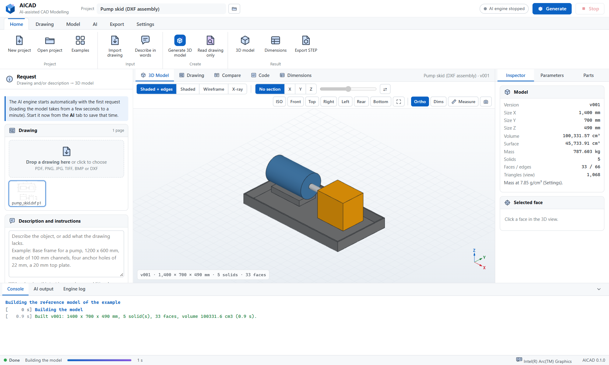
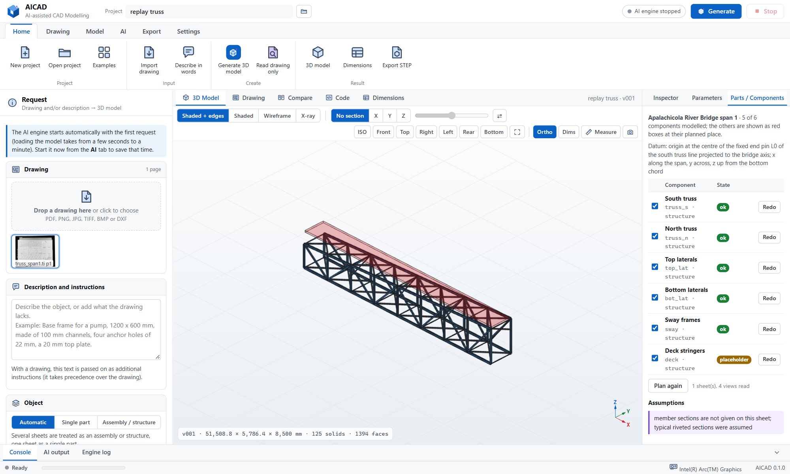

<p align="center">
  
</p>

<p align="center">
  
  
  
  
  
  
  
</p>

<p align="center">
  <b>AICAD (AI-assisted CAD Modelling)</b> turns an engineering drawing or a written description into a
  parametric 3D solid and exports it as STEP, with a local vision-language model and the OpenCASCADE kernel.
</p>

<p align="center">
  <a href="#software-description">Description</a> ·
  <a href="#workflow">Workflow</a> ·
  <a href="#cad-editing">CAD editing</a> ·
  <a href="#hardware-and-models">Hardware and models</a> ·
  <a href="#installation">Installation</a> ·
  <a href="#usage">Usage</a> ·
  <a href="#verification">Verification</a> ·
  <a href="docs/GUIDE_KO.md">User guide (Korean)</a>
</p>

<p align="center">
  
</p>

## Software description

AICAD has been developed to automate the conversion of equipment and part drawings into 3D CAD models. Drawings
are received as PDF files, scanned or photographed images, or DXF exports; for many of them no 3D model exists, and
the model has to be built by hand. AICAD reads such a drawing with a vision-language model running on the local GPU,
writes a parametric model script for the CadQuery modelling library, builds the solid on the OpenCASCADE kernel,
compares the result with the drawing view by view, and corrects the model until the two agree. The final solid is
written as a STEP file (AP214 by default, AP203 and AP242 on request) together with STL, glTF, BREP, a 2D DXF
drawing and the model script itself.

Drawings frequently omit sizes that a 3D model needs. AICAD measures such sizes on the sheet: the written dimensions
fix the scale of each view (mm per pixel), the AI marks the two ends of every missing size, and the size follows from
the measured distance. Every value used for the model is listed with its provenance - written on the drawing,
measured by ratio, stated by the user, or assumed - and can be corrected before or after modelling.

All processing takes place on the user's PC. The program, the Python runtime, the packages and the AI engine are
distributed as one offline package; the AI model is downloaded once and copied to the PC. No drawing, description or
model leaves the machine.

The main capabilities are listed below.

- **Input.** PDF (vector text is read exactly from the file, so the numbers of a CAD-exported drawing are not read
  from pixels), PNG, JPEG, TIFF (multi-page), BMP, WebP and DXF (rendered from model space; dimension entities give
  their measured values and the drawing scale is exact). A written description can replace the drawing or complement
  it with information the drawing lacks.
- **Reading.** The AI identifies the projection method, the orthographic views and their position on the sheet, every
  written dimension with its meaning, the modelling features in order, and the sizes that have to be measured. View
  boxes are snapped to the linework of the sheet; the scale is derived from each view and checked for consistency
  between views.
- **Modelling.** The model is a CadQuery script with a parameter block: every dimension is a named number with its
  source. Single parts and assemblies (several bodies with names and colours, kept as separate products in the STEP
  file) are supported. The script runs in an isolated worker process with a static safety check; a kernel failure or
  an endless loop cannot affect the program.
- **Correction.** A script that fails is returned to the AI with the error, the line and specific hints (fillet larger
  than the wall, selector without result, open profile) until it builds.
- **Comparison with the drawing.** Hidden-line projections of the model are computed in the views of the drawing.
  The overall size per axis is compared with the drawing, and the filled outline of each model view is compared with
  the outline of the corresponding drawing view (intersection over union after normalisation, with detection of
  mirrored features). The drawing views and the model views are composed side by side and returned to the AI, which
  corrects the script; the best version is kept.
- **Editing.** Parameters are changed in a table and rebuilt in a fraction of a second without the AI. Changes in
  words ("make the plate 5 mm thicker and add a 2 mm chamfer on the top edges") are applied by the AI to the current
  script. The script itself can be edited and built on the Code tab. Every build is kept as a version.
- **CAD editing.** Features are added by hand with a command line and clicks in the 3D view: hole (with counterbore
  and patterns), pocket, pad, fillet, chamfer, shell, box, cylinder, move, rotate, mirror, array and delete. Each
  command becomes a parametric feature of the model script, listed in a feature history where it can be edited,
  suppressed or deleted; undo and redo work on the versions.
- **Viewing.** Interactive 3D view with Z up, orthographic and perspective projection, shaded, edge, wireframe and
  see-through styles, a section plane with coloured cut faces, face picking (plane normal, cylinder diameter and
  axis, cone angle, area), point-to-point measurement, overall dimensions and the six standard views.

## Large objects and drawing sets

Plant structures, steel frameworks, machines and equipment are usually drawn on several sheets, often as old prints,
scans or photographs, in feet and inches, with graphic scales instead of dimensions. A single prompt cannot hold
such a set and a single script for hundreds of members fails as a whole, so AICAD models large objects in steps
that each fit the model and fail on their own:

<p align="center">
  
  
</p>

1. **Survey.** Every sheet is described at overview resolution: title, kind, units, views with their captions and
   levels, tables, scale notes and graphic scale bars.
2. **Zoomed reading.** Every main view is read again from the original file (a re-render of the PDF page or the
   full-resolution scan of up to 280 megapixels); a view drawn large is read in up to six overlapping tiles and the
   answers are merged. Dimensions, levels, grid lines, labels and member marks are converted to millimetres
   (feet-inches with fractions, inches, metres).
3. **Scale per view.** A graphic scale bar is found and measured by image analysis near the place the AI points to;
   the AI only reads its labels. A view without a bar takes the scale of the dimensions read in it (written value
   divided by the measured length, outliers removed) or the ratio of its scale note to that of a view with a bar.
4. **Plan.** The object is broken into 5 to 30 components (foundation, frames, machines, vessels, piping, platforms)
   with bounding boxes in one global coordinate system.
5. **Components.** One script per component, written with the modelling library and corrected on its own. A
   component that still fails becomes a see-through placeholder at its planned place; the rest is kept.
6. **Assembly.** One script with a builder function per component gives one version: a STEP assembly with named,
   coloured components. A component can be redone later, with an instruction, without reading the drawings again.

The **modelling library** (`aicad_lib`) gives the AI building blocks that keep large structures short and robust:
steel members and frames from node lists (HEB/HEA/IPE/UPN, H/I/C/L by size, US W shapes and inch angles, pipes,
hollow sections), plan and section outlines extruded between elevations, revolved half sections, grating, stairs,
ladders and handrails, pipes, flanges and nozzles, vessels with 2:1, hemispherical or conical heads, spiral casings,
circle-to-rectangle transitions (draft tubes, ducts, hoppers), blade rows, bolt circles and patterns.

## Workflow

<p align="center">
  
  
</p>

1. **Import** a drawing (drag and drop or Home → Import drawing) and/or describe the object in words.
2. **Generate.** The AI engine starts if it is not running and loads the model into the graphics memory.
   - *Read*: the AI returns the specification (views, dimensions, features, sizes to measure). The program snaps the
     view boxes, derives the scale and measures the missing sizes.
   - *Write*: the AI writes the CadQuery script from the table of values and the drawing.
   - *Build and correct*: the script is built; errors are corrected automatically (4 attempts by default).
   - *Compare and refine*: the model is projected into the views of the drawing and compared; the AI refines the
     script (2 rounds by default) and the version that agrees best is kept.
3. **Review** on the Dimensions tab (every value with its source), the Drawing tab (view boxes, measured sizes; boxes
   can be moved and the scale calibrated by two points of known distance) and the Compare tab.
4. **Adjust** parameters, add features with the CAD commands, ask for changes in words, or edit the script.
5. **Export** STEP (and other formats) from the Export tab.

## CAD editing

<p align="center">
  
</p>

The generated model can be finished by hand. A command is typed in the command line under the 3D view (typing
anywhere in the window goes there) or started from the **Edit** tab of the ribbon. The command then asks, step by
step, for what it needs: a face or edges clicked in the 3D view, and values typed in the command line.

- **Enter** takes the default shown in `< >`; Enter on an empty line repeats the last command; **Esc** cancels.
- Several values can be given at once as `key=value`, e.g. `pad shape=circle w=30 height=25` or
  `hole d=13.5 count=4 pitch=0,60,0`. The position is the clicked point, or `at=x,y,z`, shifted by `offset=dx,dy,dz`.
- ↑ and ↓ recall earlier commands; **Ctrl+Z** and **Ctrl+Y** undo and redo.

| Command (alias) | Picks | Values |
|---|---|---|
| `hole` (h) | face | diameter, depth (0 = through); `cbore=`, `cdepth=`, `count=`, `pitch=` |
| `pocket` (p) | face | shape rect / circle / slot, width, height, depth; `angle=`, `count=`, `pitch=` |
| `pad` (boss, extrude) | face | shape, width, height of the outline, pad height |
| `fillet` (f), `chamfer` (c) | edges, Enter when done | radius / size |
| `shell` | the face to open | wall thickness |
| `box` (b), `cylinder` (cyl) | the face it stands on | sizes; join: add, cut or new body |
| `move` (m), `rotate` (ro) | body or component | displacement / axis and angle about the clicked point |
| `mirror` (mi), `array` (ar) | body or component | plane / number of copies and step |
| `delete` (del) | component | removes a component of an assembly |

Each command becomes a feature block at the end of the model script. Faces and edges are referenced by the clicked
point (the nearest face or edge of the current solid is taken), so features usually stay valid when parameters further
up change; a feature whose point no longer lies on the intended face is corrected in the History. The **History** tab on the right lists the features: double-click (or ✎) to edit the values, ○ to
suppress, ✕ to delete. The model is rebuilt without the AI in about a second.

## Hardware and models

The AI engine is llama.cpp with CUDA 12.4 (Vulkan and CPU builds are included as well). The model is chosen
automatically from the graphics memory of the PC; any other GGUF vision model can be placed in `models/`.

| Profile | Model (Hugging Face, Apache-2.0) | Weights + vision projector | Context | Intended GPU |
|---|---|---|---|---|
| `qwen3.6-27b-q6` | Qwen3.6-27B, Q6_K ([unsloth/Qwen3.6-27B-GGUF](https://huggingface.co/unsloth/Qwen3.6-27B-GGUF)) | 22.5 + 0.9 GB | 65 536 | 48 GB (RTX 6000 Ada) |
| `qwen3.6-27b-q4` | Qwen3.6-27B, Q4_K_M | 16.8 + 0.9 GB | 32 768 | 24 GB (RTX 4090) |
| `qwen3.6-35b-a3b-q4` | Qwen3.6-35B-A3B, Q4_K_M ([unsloth/Qwen3.6-35B-A3B-GGUF](https://huggingface.co/unsloth/Qwen3.6-35B-A3B-GGUF)) | 22.1 + 0.9 GB | 65 536 | 48 GB, optional, faster |
| `qwen3.6-35b-a3b-iq2` | Qwen3.6-35B-A3B, IQ2_XXS (projector Q8_0 from [ggml-org](https://huggingface.co/ggml-org/Qwen3.6-35B-A3B-GGUF)) | 10.8 + 0.6 GB | 32 768 | 12-16 GB, or CPU with 16 GB RAM |
| `qwen3.5-9b-q4` | Qwen3.5-9B, Q4_K_M | 5.7 + 0.9 GB | 32 768 | 8-16 GB or CPU |
| `qwen3.5-4b` | Qwen3.5-4B, Q4_K_M | 2.7 + 0.7 GB | 16 384 | CPU trial only |

Qwen3.6-27B is a dense vision-language model with a native context of 262 144 tokens. It is the largest model of
its series that fits both a 48 GB and a 24 GB card with the context the pipeline needs (drawing image, specification,
script, comparison image); the quantisation is chosen per card. Reasoning ("thinking") is used for reading, writing
and changes, and switched off for error correction; each can be set on the AI tab. On the CPU engine reasoning is
always off.

## Installation

AICAD runs on Windows 10 and 11 (x64). Neither administrator rights nor an internet connection are needed on the
PC where it runs.

1. Download `AICAD-0.1.0-offline-win64.zip` from the [latest release](https://github.com/HyoseokByun-opt/AICAD/releases/latest)
   and unpack it to a short path such as `C:\AICAD`.
2. Run `1_INSTALL_OFFLINE.bat`. It unpacks the Python runtime into `python\`, installs the bundled packages and runs
   the self-test. Deleting the `python\` folder undoes the installation.
3. On a PC with internet access, run `3_GET_AI_MODEL.bat` and choose the profile for the target GPU (1 = RTX 4090,
   2 = RTX 6000 Ada, 3 = both). The download resumes after an interruption and every file is checked against its
   SHA-256 digest. Copy the `models\` folder to the offline PC. A proxy is used if `HTTPS_PROXY` is set.
4. Start the program with `2_RUN_AICAD.bat`; the browser opens at `http://127.0.0.1:8100`.
   `5_RUN_SERVER.bat` serves it to other PCs on the local network, with the AI running on the GPU of this PC.

The NVIDIA driver must support CUDA 12.4 (driver 551.61 or newer). `4_SELF_TEST.bat` checks the installation;
`4_SELF_TEST.bat --ai` also loads the model and asks it one question.

**From source.** `git clone`, then `python tools/build_offline.py` on a PC with internet downloads the runtime, the
wheels and the llama.cpp builds into the folder; continue with step 2.

## Usage

| Task | Where |
|---|---|
| Model from a drawing | Import the drawing → **Generate** |
| Model from words | Type the description on the Home tab → **Generate** |
| Plant, structure, machine, several sheets | Import all sheets → Object: *Assembly / structure* (automatic for several sheets) → **Generate** |
| Redo one component | Parts / Components → *Redo* (optionally with an instruction) |
| Check what was read | **Dimensions** tab: every value, its source and the open questions |
| Fix a wrong view box or the scale | **Drawing** tab → *Edit view boxes*, *Calibrate scale* |
| Rebuild from corrected values | Dimensions tab → *Build model from these values* |
| Change a size | **Parameters** (right panel) → *Apply* |
| Add a hole, pocket, fillet ... by hand | Type the command (or **Edit** tab), click the face, type the values |
| Change or remove a hand-made feature | **History** (right panel): double-click, hide, delete; Ctrl+Z |
| Change the design in words | AI tab → *Change the model by instruction* |
| Improve agreement with the drawing | Compare tab → *Refine against drawing* |
| Measure the model | 3D toolbar → *Measure*; click a face for its geometry |
| Export | Export tab → STEP, STL, glTF, BREP, DXF, code |

Nine examples are included (Home → Examples). Six are synthetic drawings with known answers: a base plate (raster),
a pipe flange (vector PDF), an L bracket whose wall thickness is not dimensioned, a pump skid assembly (DXF), and two
descriptions (a vertical vessel and a stepped shaft). Three are real drawings from the Historic American Engineering
Record (public domain, Library of Congress): the 1925 turbine and generator unit of Wilson Dam (a half section
without any dimensions, two scales on one sheet), a photographed 1934 erection plan of a steel deck truss, and three
21 600 x 13 000 px sheets of a nuclear power plant turbine building. The first two come with a reference layout
model built with the modelling library.

## Verification

`app/selftest.py` checks the parts that do not depend on the AI against known answers: the kernel, the code safety
check and error lines, lengths written in feet-inches and metric, 36 known-answer cases of the modelling library (building blocks and editing operations), the CAD features (generated,
edited, suppressed and rebuilt), the STEP round trip (identical volume after re-import, part name kept), PDF, DXF and image
import (exact texts and dimension values), all example references, the scale derived from the views (within 2 % of
the true scale), a size that is not dimensioned measured by ratio (L bracket wall: 10 mm), the outline comparison of
drawing and model, and every export format. `tools/eval_examples.py` runs all examples through the complete AI
pipeline on the GPU PC and reports the size and volume error of each result against its reference.

The real drawings were used to test the steps that do not depend on the size of the model:

| Check on real drawings | Result |
|---|---|
| Import of eight HAER sheets (1-bit TIFF up to 21 634 x 13 056 px, photographed prints) | all imported, under 1 s each |
| Scale bar of the Wilson Dam sheet, measured (AI: labels only) | 5.962 mm/px (feet bar and metre bar agree within 0.2 %) |
| Second scale on the same sheet (1/16" = 1'-0" key plan) | 35.76 mm/px from the ratio of the scale notes |
| Survey of the Wilson Dam sheet with Qwen3.5-9B on a CPU | title, units (ft-in), both views snapped to their outlines, both scale notes |
| Assembly pipeline on the truss sheet with recorded AI answers | 6 components, 125 members, correction and placeholder work, STEP assembly |
| Reference layout model of the turbine unit (library) | 9 components, 112 solids, built in 18 s |

The accuracy of the AI depends on the model and on the drawing. Results are to be checked on the Dimensions and
Compare tabs before use; values marked *ratio* or *assumed* deserve particular attention. A drawing that is not to
scale (NTS) makes measured sizes meaningless; the program warns when the views give inconsistent scales.

## Project layout

```
app/aicad/      ingest (PDF, image, DXF) · vision (view boxes, outlines, zoomed crops) · spec (scale, ratio sizes)
                units (feet-inches) · scalebar · llm (llama.cpp engine) · prompts · pipeline (single parts)
                assembly (sheets, components) · lib (modelling library) · cadexec (kernel worker) · params · project
app/web/        Flask server, user interface (three.js viewer, drawing viewer)
examples/       example drawings with reference models
tools/          get_model, build_offline, make_examples, eval_examples, survey_test, replay_assembly_test, make_release
```

## Open-source components

AICAD is built on [CadQuery](https://github.com/CadQuery/cadquery) and the [OpenCASCADE](https://dev.opencascade.org/)
kernel (via [cadquery-ocp](https://github.com/CadQuery/OCP)), [llama.cpp](https://github.com/ggml-org/llama.cpp),
the [Qwen3.6 and Qwen3.5](https://huggingface.co/Qwen) models (GGUF conversions by [Unsloth](https://huggingface.co/unsloth)),
[three.js](https://threejs.org/), [Flask](https://flask.palletsprojects.com/), [Waitress](https://github.com/Pylons/waitress),
[pypdfium2](https://github.com/pypdfium2-team/pypdfium2) (PDFium), [OpenCV](https://opencv.org/),
[ezdxf](https://github.com/mozman/ezdxf), [Pillow](https://python-pillow.org/) and [NumPy](https://numpy.org/).
Each keeps its own licence (see `LICENSE`).

## Authors and licence

Hyoseok Byun. Released under the MIT licence.

AI-assistance declaration: the software and its documentation were developed with the assistance of Claude
(Anthropic), which wrote code under the direction of the author.
